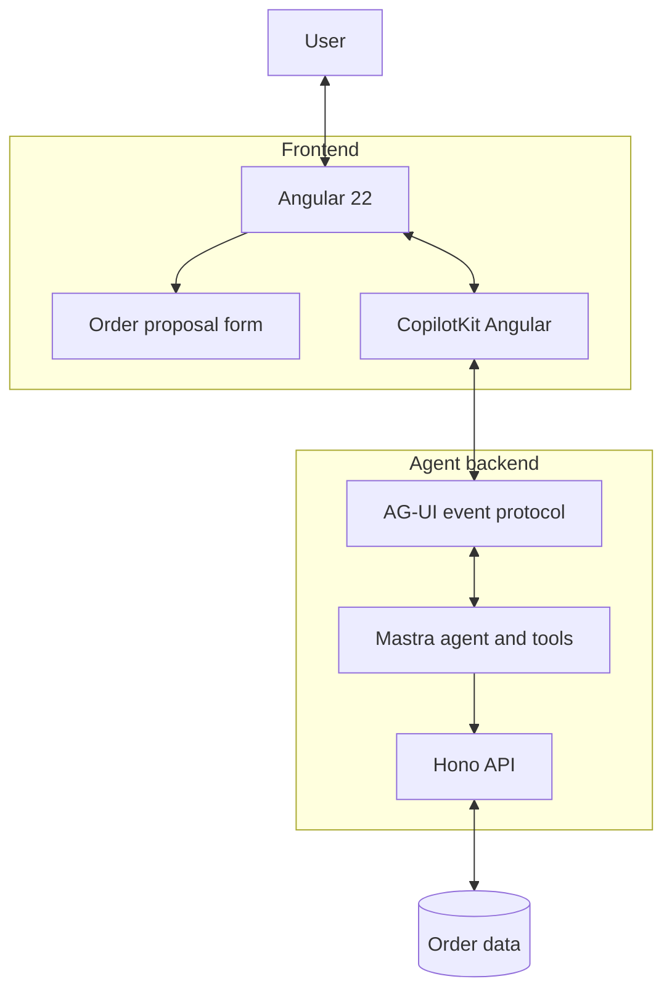
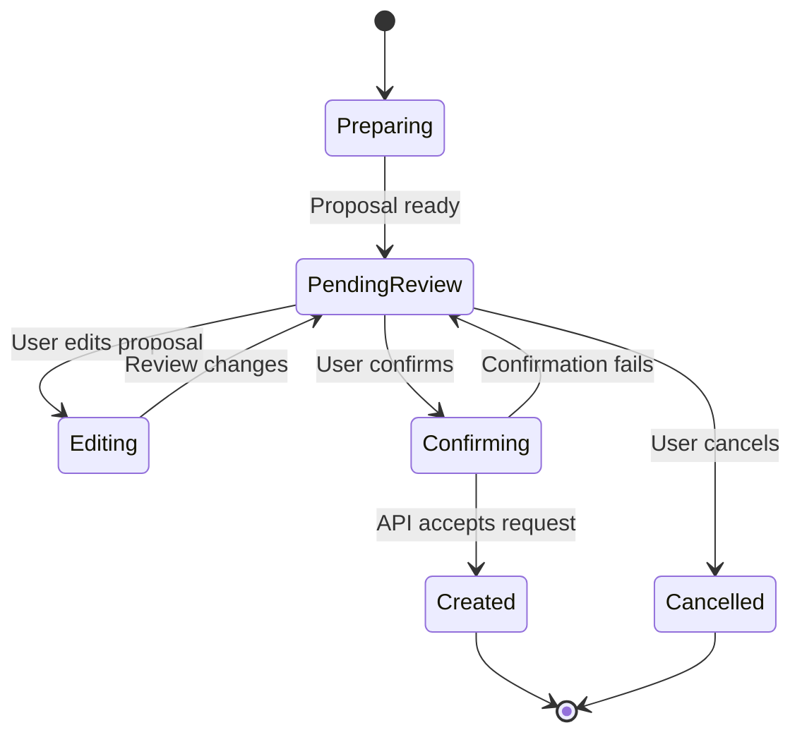

# Order Agentique

> An agentic order management application built with Angular 22, CopilotKit, AG-UI, Mastra, and Hono.

Order Agentique explores how AI agents can collaborate with users inside a modern web application. The agent can prepare an order proposal, while the user remains in control: reviewing, editing, confirming, or cancelling the proposal before the order is created.

> **Project status:** Experimental / learning project. Update this section to reflect the current implementation and production readiness.

## Overview

Traditional interfaces often follow a request–response model. Agentic interfaces introduce a more dynamic interaction: an agent can work through multiple steps, invoke tools, and communicate progress while the user follows the process.

This project demonstrates an architecture in which:

- **Angular 22** provides the user interface and form experience.
- **CopilotKit** integrates the agent interaction into the frontend.
- **AG-UI** provides a protocol for exchanging structured events between the frontend and the agent.
- **Mastra** orchestrates the agent and its tools.
- **Hono** exposes backend endpoints for order-related operations.
- **Server-Sent Events (SSE)** can stream events to the frontend where configured by the integration.

The exact responsibilities and transport flow depend on the implementation in this repository.

## Key features

- **AI-assisted order preparation** — request a proposed order through a conversational interface.
- **Editable order proposals** — review and modify customer details, items, and total before confirming.
- **Human-in-the-loop confirmation** — a proposal is not treated as a persisted order until the confirmation flow succeeds.
- **Cancellation flow** — discard a pending proposal without creating an order.
- **Event-driven interaction** — represent agent progress and results through the AG-UI integration.
- **Angular Signal Forms** — model form state and validate user input.
- **Separated responsibilities** — keep UI concerns, agent orchestration, and business API operations distinct.

Feature availability depends on the current implementation. Consult the source code for the authoritative behavior.

## Architecture



### Order proposal lifecycle



## Technology stack

| Area | Technology | Responsibility |
|---|---|---|
| Frontend | Angular 22 | UI and application state |
| Forms | Angular Signal Forms | Form state and validation |
| Agent UI integration | CopilotKit Angular | Connect the UI to agent interactions |
| Interaction protocol | AG-UI | Structured agent–user events |
| Agent framework | Mastra | Agent and tool orchestration |
| Backend API | Hono | HTTP endpoints |
| Streaming | SSE, where configured | Deliver server-sent events |

## Getting started

The commands below are a template. Check the repository's `package.json`, workspace configuration, and environment files to confirm the exact package manager, script names, and ports before running them.

### Installation

Clone the repository:

```bash
git https://github.com/Balha147/order-agentique.git
cd order-agentique
```

Install dependencies using the package manager configured by the project. For example, if the repository uses npm:

```bash
npm install
```

### Run the application

This repository may use separate scripts for the Angular frontend and the agent API. Inspect the root and application-level `package.json` files, then start each application with the documented script.

For example, in a workspace that defines these scripts:

```bash
npm run dev
```

If frontend and backend are started separately, run their respective scripts in separate terminals. Confirm the actual commands and local URLs from the project configuration.

### Environment configuration

Create the required local environment files based on the examples provided in the repository, if any. Configure API URLs and any credentials required by the agent runtime.

- Do not commit API keys, tokens, or other secrets.
- Keep `.env.example` free of real credentials.
- Document required variables and their purpose.
- Use local development values only in local configuration files.

## Example workflow

1. The user asks the agent to prepare an order.
2. The agent prepares a proposal and returns the relevant result to the application.
3. Angular displays the proposal in an editable form.
4. The user reviews the customer, items, and total.
5. The user confirms or cancels the proposal.
6. On confirmation, the backend validates the request and creates the order if it is accepted.
7. The frontend reflects the result returned by the API.

The frontend's validation improves usability but is not a substitute for backend validation. The server must enforce business rules and authorization.

## Engineering considerations

### Human control

Treat an AI-generated proposal as input for review, not as an automatically authorized business operation. Make confirmation and cancellation states clear to the user.

### Validation and security

Validate all business-critical data on the server. Apply authentication and authorization where required, and never trust tool arguments or values submitted by the browser solely because they originated from an agent.

### Error handling

Represent loading, success, and failure states clearly. Avoid displaying an order as created until the backend returns a valid successful response. Consider idempotency protections for operations that could otherwise create duplicate orders.

### Maintainability

Keep UI presentation, agent integration, and business API responsibilities separate. This makes the workflow easier to test and evolve.

## Project structure

The following is a conceptual view; update it to match the actual repository layout.

```text
order-agentique/
├── apps/
│   ├── web/          # Angular frontend
│   └── agent-api/    # Hono API and Mastra agent
├── README.md
└── ...
```

## Documentation

- [AG-UI documentation](https://docs.ag-ui.com/)
- [CopilotKit documentation](https://docs.copilotkit.ai/)
- [Mastra documentation](https://mastra.ai/docs)
- [Angular documentation](https://angular.dev/)
- [Hono documentation](https://hono.dev/)

### Further reading — Angular Architects

- [Understanding AG-UI: The Standard for Agentic User Interfaces](https://www.angulararchitects.io/en/blog/understanding-ag-ui-the-standard-for-agentic-user-interfaces/)
- [AG-UI in Practice: The SDK for TypeScript](https://www.angulararchitects.io/en/blog/ag-ui-in-practice-the-sdk-for-typescript/)
- [AG-UI in Practice: End-to-End — Connecting Server and Client](https://www.angulararchitects.io/en/blog/ag-ui-in-practice-ag-ui-end-to-end-connecting-server-and-client/)
- [Implementing AG-UI with Angular](https://www.angulararchitects.io/en/blog/implementing-ag-ui-with-angular/)
- [A2UI: How AI Generates Dynamic UIs at Runtime](https://www.angulararchitects.io/en/blog/a2ui-how-ai-generates-dynamic-uis-at-runtime/)
- [Integrating A2UI with AG-UI in Angular](https://www.angulararchitects.io/en/blog/integrating-a2ui-with-ag-ui-in-angular/)

